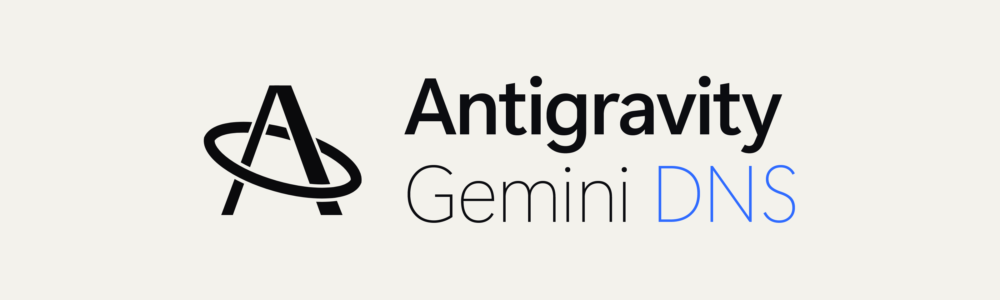
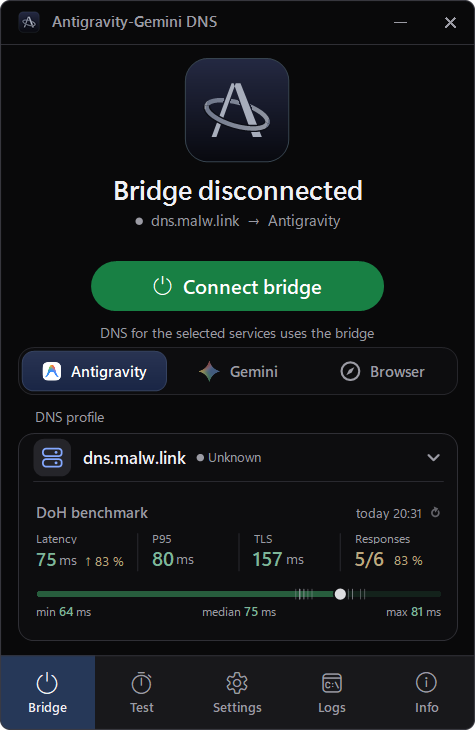
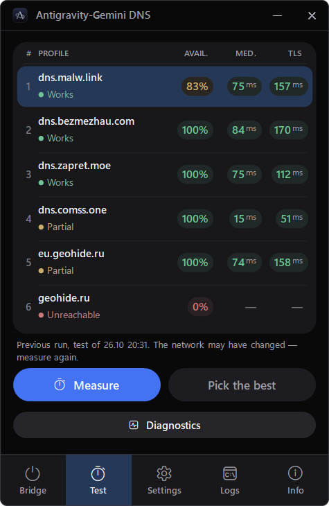

<picture>
  <source media="(prefers-color-scheme: dark)" srcset="../../assets/brand/hero-dark.png">
  
</picture>

[Русский](../../README.md) · **English**

Antigravity-Gemini DNS is a Windows app that finds a working DNS/DoH profile and applies it only to the services you choose: Antigravity, Gemini and related Google services in the browser. The rest of your computer's network is left as it was.

**[Download the latest release](https://github.com/narechiyaprincess/Antigravity-DNS/releases/latest)** · Windows 11 x64 · portable EXE, no .NET install needed · [changelog](../../CHANGELOG.md)

> The sources on `main` are version 1.1.0. Until its release is published, the download link still serves 1.0.0. If you are upgrading from 1.0.0, read [how to upgrade](#upgrading-from-100) first.

<p align="center">
  
  
</p>
<p align="center"><sub>The 1.1.0 window: the main screen and the Test tab. Measurements come from one network; yours will differ.</sub></p>

## What it does

- **Choose the services.** Antigravity, Gemini and Google browser services are switched independently; the bridge touches only the ones you select.
- **Measure profiles.** Checks availability, latency and TLS for the built-in DNS/DoH profiles, suggests the best one from fresh results and keeps a history. You can add your own DoH provider.
- **Direct first.** When direct access to a service is confirmed, no bridge is created and system settings stay unchanged.
- **Careful connect and restore.** The app changes only its own name-resolution rules and can remove them again. Foreign or modified entries are left alone.
- **Diagnostics.** Checks the network, DNS rules, the provider, and conflicts with a VPN or browser Secure DNS, and reports each check separately.
- **Everyday details.** Russian and English UI, tray icon, failure notifications, autostart, settings export/import and a support report you can preview.

## Quick start

1. Download the EXE from the release page, compare its SHA-256 with `SHA256SUMS.txt` and keep it in a permanent folder.
2. On the Bridge tab, choose the services and the DNS profile. To choose a profile by actual results, open Test and click Measure.
3. Click Connect bridge, confirm provider trust and approve the Windows UAC prompt if it appears.
4. Check the service itself: a connected bridge does not mean that sign-in or model access will work.
5. To undo the changes, use Disconnect or Restore. Closing the window or quitting from the tray does not restore DNS.

### Upgrading from 1.0.0

First disconnect the bridge with the old version, make sure restoration has finished and close it. Only then start 1.1.0; never run both versions at once. There is no automatic downgrade to 1.0.0: once 1.1.0 has written its journal in the new format (Schema 2), the old version cannot read it. Keep `state.json` and the 1.1.0 EXE for recovery, do not delete the journal and do not clear NRPT rules by hand. Details: [release notes](../RELEASE-NOTES-1.1.0-EN.md#upgrade-and-downgrade) and [compatibility](../COMPATIBILITY-IDENTIFIERS.md).

## How it works and whom you trust

For the domains of the selected services, the app creates Windows NRPT rules that send their DNS queries to the chosen DoH provider. Such a provider may answer with the addresses of its own proxy, in which case part of those services' traffic passes through it. The provider is therefore a party you trust: it sees the selected services' DNS queries and may relay their traffic. DoH encrypts the DNS queries themselves, not all of your computer's traffic. TLS certificate checks remain enabled.

- This is not a VPN and not a guarantee of access: passing DNS and TLS checks does not mean that your account, model or service will work on your network.
- VPN/TUN, corporate policies and browser Secure DNS can bypass the system resolver. The app does not reconfigure them, but Diagnostics points out the conflict.
- Connecting and restoring need administrator rights. Background auto-repair never triggers UAC; if you enable "Run as administrator", operations run without new prompts after its first approval. The EXE is unsigned, so Windows may show a warning.
- The verified platform is Windows 11 x64 with PowerShell 5.1 and working CIM/WMI. Windows 10, ARM64 and a clean Windows install have not been tested.
- Built-in providers are trusted once for the whole catalog; a custom DoH provider needs its own consent. Trust can be revoked in Settings.

Known limitations of the current version are listed in the [release notes](../RELEASE-NOTES-1.1.0-EN.md#limitations).

## Help

If a service does not open, click Diagnostics on the Test tab and look at Logs. Before sharing a support report, check its preview and remove personal details.

[Troubleshooting](TROUBLESHOOTING.md) · [Report a bug](https://github.com/narechiyaprincess/Antigravity-DNS/issues/new/choose) · [Security](../../SECURITY.md) · [Changelog](../../CHANGELOG.md)

## For developers

Build from the repository root with the SDK pinned in `global.json`:

```powershell
powershell.exe -NoProfile -ExecutionPolicy Bypass -File .\src\app\Build.ps1
```

Output: `src\.work\build\AntigravityGeminiDns.exe`. The recipe keeps the full WinForms runtime (`PublishTrimmed=false`).

[Build and checks (Russian)](../BUILDING.md) · [Architecture](TECHNICAL.md) · [Release process (Russian)](../RELEASING.md) · [Contributing](../../CONTRIBUTING.md) · [Attribution](../ATTRIBUTION.md)

## License

MIT — [LICENSE](../../LICENSE). Provided without warranty; the project does not control third-party providers or service availability.
